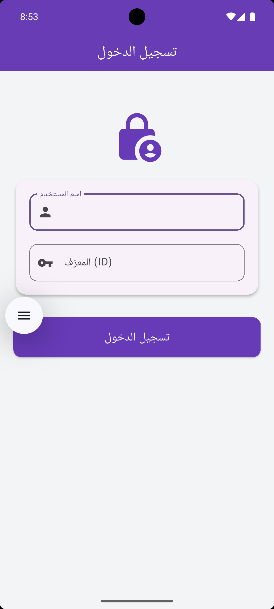
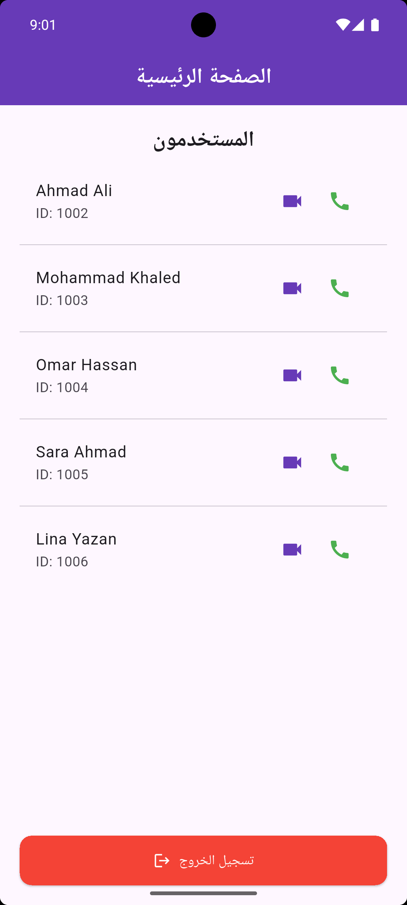

# CallMe — Flutter Voice & Video Calling App

A Flutter mobile calling application built around a simple user directory and real-time voice/video calling.

> **Portfolio note:** The original backend URL included in the development version is no longer active. This repository uses placeholders for the backend URL and ZEGO credentials so private service credentials are not committed to GitHub.

## Screenshots

### Login


### User Directory


## Features

- User sign-in with username and ID
- Persistent login state using `shared_preferences`
- User directory with user IDs
- One-tap voice calling
- One-tap video calling
- ZEGO UI Kit integration for calling and signaling
- Firebase initialization support from the original project
- Simple Arabic user interface
- Clean, lightweight Flutter UI

## Tech Stack

| Technology | Purpose |
| --- | --- |
| Flutter / Dart | Mobile application |
| ZEGO UI Kit | Voice and video calling |
| ZEGO Signaling | Call signaling |
| Firebase Core | Firebase initialization |
| Firebase Messaging | Messaging dependency included in the original project |
| Shared Preferences | Local session persistence |
| HTTP | Communication with the PHP backend |

## Project Structure

```text
lib/
├── main.dart
├── login.dart
├── homepage.dart
├── callservices.dart
├── constant.dart
└── firebase_options.dart

assets/
└── call.png

screenshots/
├── login-screen.png
└── home-screen.png
```

## Configuration

The original project uses three external integrations:

1. A PHP backend for registering users and retrieving the user list.
2. ZEGO App ID / App Sign for voice and video calling.
3. Firebase configuration included by FlutterFire.

For GitHub safety, the ZEGO App Sign and the old backend address are not stored in this repository.

### ZEGO configuration

Run the app with:

```bash
flutter run   --dart-define=ZEGO_APP_ID=YOUR_ZEGO_APP_ID   --dart-define=ZEGO_APP_SIGN=YOUR_ZEGO_APP_SIGN   --dart-define=CALLME_API_BASE_URL=https://YOUR-BACKEND-DOMAIN/callme
```

On Windows PowerShell, the same command can be written on one line:

```powershell
flutter run --dart-define=ZEGO_APP_ID=YOUR_ZEGO_APP_ID --dart-define=ZEGO_APP_SIGN=YOUR_ZEGO_APP_SIGN --dart-define=CALLME_API_BASE_URL=https://YOUR-BACKEND-DOMAIN/callme
```

## Backend API Expected by the Original App

The Flutter code expects these endpoints under the configured base URL:

```text
POST /signup.php
GET  /getuser.php
```

`signup.php` expects:

```text
username
id
```

The original application handled successful registration using the response `success` and an existing user using `exists`.

## Getting Started

```bash
flutter pub get
flutter run
```

Before a fully functional calling session, configure valid ZEGO credentials and an active backend.

## Project Status

The UI and Flutter client are suitable for portfolio presentation and screenshots. The original hosted backend is no longer active, so server-backed features require a replacement backend or a reactivated deployment.

## License

This project is released under the MIT License. See [LICENSE](LICENSE).
